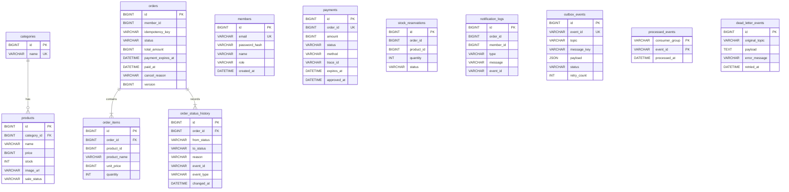

# shop-mall

포트폴리오용 쇼핑몰. 주문 → 모의 결제 → 결과 이벤트를 Kafka 로 잇고, 재고·세션·캐시·멱등 키를 Redis 로 처리한다.
요구사항 정본: `../요구사항정의서_엑셀양식_v3_1_10.xlsx` (대분류 ShopMall).

현재 단계
- **1단계 기반** — 골격(REQ-F-001), 스키마·엔티티·상태 전이(REQ-DA-001), 이벤트 테이블(REQ-DA-002 스키마만),
  Redis 키 계약(REQ-IF-003), 비밀값 분리(REQ-SE-003), 시드(REQ-DA-003), traceId 로그 기반(REQ-NF-003).
- **2단계 회원·상품·장바구니·관리자** — 회원가입·로그인·Redis 세션(REQ-F-002), 권한·CSRF·로그인 잠금(REQ-SE-001),
  상품 목록·검색(REQ-F-003), 상세·JSON 캐시(REQ-F-004), Redis Hash 장바구니(REQ-F-005), 관리자 상품·재고(REQ-F-013),
  공통 오류 응답 `{code, message}`(REQ-IF-001 7).
- **3단계 이벤트 인프라·주문·재고 선점** — 토픽·봉투(REQ-IF-002), 아웃박스·발행기(REQ-DA-002), 멱등 소비·재시도·DLT
  (REQ-NF-002), traceId 전파(REQ-NF-003 1), 주문서·주문 API(REQ-F-006), Lua 선점·확정·복원(REQ-F-007), 멱등 키(REQ-SE-002).
- **4단계 결제·보상·조회** — 모의 결제(REQ-F-008), 결과 소비·결제 취소 요청(REQ-F-009), 결제 시간 초과 자동 취소(REQ-F-010),
  사용자 취소·보상(REQ-F-011), 주문 내역·타임라인(REQ-F-012), 관리자 이벤트 화면·DLT 재처리·장애 스위치(REQ-F-014),
  REST 목록 완성(REQ-IF-001), 주문 1건 traceId 추적(REQ-NF-003 검증 1).
- **5단계 검증·문서** — 동시 주문 재고 정합성 테스트·k6 부하 테스트(REQ-NF-001), 처리 중 강제 종료 후 재처리(REQ-NF-002 3),
  JaCoCo 커버리지(REQ-NF-004), 주문 로그 개인정보 검사(REQ-SE-003 2), 아키텍처·시퀀스·ADR 문서(REQ-NF-005).

설계 문서: [아키텍처(모듈·토픽·Redis 키)](docs/architecture.md) · [시퀀스 4종](docs/sequences.md) · [ADR 6건](docs/adr/README.md)

## 기술 스택

Java 17 · Spring Boot 3.3.4 · Maven · Thymeleaf · MySQL 8.4 + JPA + Flyway · Spring Kafka (Apache Kafka 3.9 KRaft) ·
Spring Data Redis + Spring Session (Redis 7.4) · JUnit 5 + Testcontainers 1.21.4

## 실행

```bash
cp .env.example .env          # 값 채우기 (DB_PASSWORD, DB_ROOT_PASSWORD, REDIS_PASSWORD). .env 는 커밋 금지
docker compose up -d          # mysql · kafka · kafka-ui · redis (모두 healthcheck)
mvn -q package                # 테스트까지 돈다(약 2분). 빌드만: mvn -q package -DskipTests
set -a; . ./.env; set +a
java -jar target/shop-mall-0.0.1-SNAPSHOT.jar   # 기본 프로파일 local
```

- 메인 `http://localhost:8080/`, 헬스 `http://localhost:8080/actuator/health` (db · redis · kafka 구성요소 포함)
- kafka-ui `http://localhost:8089` (컨슈머 lag 확인용)
- 호스트 3306 이 이미 쓰이면 `.env` 의 `DB_PORT` 를 바꾼다 (예: 3307)
- 끝낼 때: 앱 Ctrl+C → `docker compose down` (데이터까지 지우려면 `docker compose down -v`)

## 시연 시나리오

시드 계정(아래 표)으로 로그인한다. 결제 시간 초과를 바로 보려면 앱을 띄우기 전에 `.env` 에 `SHOP_PAYMENT_TIMEOUT=1m`.

1. **주문 → 결제 성공**: user1 로그인 → 상품 상세 → [바로 주문] → 주문서 [결제하기] → 모의 결제 화면(상단에 "포트폴리오용 모의 결제 —
   실제 결제되지 않음") → [결제 성공] → 상태 폴링 후 주문 상세에 PAID, 타임라인에 원인 이벤트, 알림 1건.
2. **결제 실패 → 재고 복원**: 다른 주문에서 [결제 실패] → PAYMENT_FAILED, 상품 상세의 가용 재고가 주문 전 값으로 돌아온다.
3. **시간 초과 자동 취소**: 결제 화면에서 아무것도 누르지 않고 1분 대기 → 주문 CANCELLED(PAYMENT_TIMEOUT), 재고 복원.
4. **사용자 취소**: PAID 주문 상세에서 [주문 취소] → CANCELLED, DB·Redis 재고 복원, 결제 CANCELLED(모의 환불), 알림.
5. **동시 주문**: 5번 상품(재고 10)을 user1·user2 두 브라우저에서 동시에 주문하거나 k6(아래)로 100명을 붙여 본다 → 10개만 팔린다.
6. **이벤트 추적·DLT**: admin 로그인 → `/admin/events?orderId={주문번호}` 에서 발행·소비 기록 확인. 장애 스위치로
   `shop-notification` 1건 실패를 걸고 결제 → DLT 목록에 1건 → [재처리] → 알림 그룹만 처리된다.
7. kafka-ui(`http://localhost:8089`)에서 토픽 6개 + `.DLT`, 컨슈머 그룹 lag 를 본다.

## 프로파일

| 프로파일 | 용도 | Flyway 위치 |
|---------|------|-------------|
| `local` (기본) | docker compose 인프라 + 시연 시드 | `db/migration`, `db/seed` |
| `test` | Testcontainers 가 접속 정보를 주입, 시드 없음 | `db/migration` |

## 테스트

```bash
mvn test     # Docker 만 있으면 된다. 로컬 compose 인프라를 쓰지 않는다 (REQ-NF-004)
```

- 통합 테스트는 `support/IntegrationTestSupport`(빈 스키마) 또는 `support/SeededIntegrationTestSupport`(시드 적용,
  MockMvc) 를 상속한다. MySQL · Kafka · Redis 컨테이너는 JVM 당 한 번만 뜬다 (`support/TestInfrastructure`).
- 시드 컨텍스트는 같은 컨테이너에서 별도 DB(`shop_seed`)와 Redis DB 1 을 쓴다. 시드 행이나 Redis 값을 바꾸는 테스트는
  끝나면 원래대로 되돌린다 (모든 하위 클래스가 컨텍스트 하나를 공유).
- 시드 계정 principal 은 `support/SeedMembers` 에 있다.
- Kafka 는 컨텍스트마다 브로커가 따로 있다(`KAFKA`, `SEED_KAFKA`). 두 컨텍스트가 같은 토픽·컨슈머 그룹을 쓰므로 한 브로커를
  공유하면 한쪽이 발행한 이벤트를 다른 쪽(다른 DB) 컨슈머가 가져갈 수 있다.
- 빈 스키마 컨텍스트에서 상품이 필요하면 `support/TestProducts`, Kafka 직접 송수신·소비 완료 대기는 `support/KafkaTestClient`.
- 앱을 **별도 JVM** 으로 띄워 SIGKILL 해야 하는 테스트는 `support/ApplicationProcess`(로그 `target/app-process/*.log`).
  `ConsumerCrashRecoveryTest` 는 브로커를 따로 하나 더 띄우고 DB `shop_crash`·Redis DB 2 를 쓴다.
- 커버리지: `mvn test` 가 `target/site/jacoco/index.html` 을 만든다 (JaCoCo 0.8.12).

### REQ-NF-004 통합 시나리오 5종

| 시나리오 | 테스트 |
|----------|--------|
| 주문 → 결제 성공 → PAID | `PaymentFlowTest.successfulPaymentPaysTheOrderConfirmsStockAndNotifiesOnce` |
| 결제 실패 → 재고 복원 | `PaymentFlowTest.failedPaymentFailsTheOrderAndRestoresStock` |
| 타임아웃 취소 | `PaymentTimeoutJobTest.overdueOrderIsCancelledAndItsStockAndPaymentAreReleased` |
| 취소 보상 | `PaymentFlowTest.cancelAfterPaymentRestoresDatabaseAndRedisStockAndCancelsThePayment` |
| DLT | `EventConsumptionTest.failingRecordIsTriedFourTimesThenDeadLetteredAndTheNextRecordIsHandled` |

단위: 상태 전이표 `OrderTest`·`PaymentTest`, 금액 계산 `OrderTest`, Lua 스크립트(Redis 컨테이너) `StockReservationFlowTest`.

커버리지 (2026-11-06, `mvn test` 140건): 라인 95.5%(1,539/1,612), 브랜치 81%(244/298). 참고 목표 70% 이상.

## 동시성 검증과 부하 테스트 (REQ-NF-001)

### 통합 테스트 — `stock/StockConcurrencyTest`

재고 100 상품에 회원 200명이 주문 API(`POST /api/orders`)로 1개씩 **동시에**(스레드 200개, 시작 래치) 주문한다.

| 항목 | 기대 | 결과 |
|------|------|------|
| 1) 성공 / 실패 | 정확히 100 / 100 (`409 OUT_OF_STOCK`) | 일치 |
| 1) Redis 가용 재고 · RESERVED 합계 · 주문 행 | 0 · 100 · 100 | 일치 |
| 2) 결제 성공 60 · 실패 40 (동시 승인) 후 DB 재고 / Redis | 40 / 40, CONFIRMED 60 · RELEASED 40 | 일치 |
| 10회 연속 실행 | 플래키 0 | **10/10 통과** (2026-11-06, 회당 약 21~25초) |

```bash
for i in $(seq 1 10); do mvn -q test -Dtest=StockConcurrencyTest -Dsurefire.rerunFailingTestsCount=0 || break; done
```

### 부하 테스트 — k6 (`load-test/order-concurrency.js`)

동시 사용자 100명(VU)이 같은 상품을 1개씩 10번씩(총 1,000건) 주문한다. 시작 전에 관리자 계정으로 상품 DB 재고를 `STOCK` 으로
맞추고, 상품 상세의 가용 재고를 앞뒤로 읽어 서버 쪽 판매 수도 센다. 위 "실행" 대로 앱을 띄운 뒤:

```bash
docker run --rm -v "$PWD/load-test:/scripts" -e BASE_URL=http://host.docker.internal:8080 \
    grafana/k6:0.54.0 run /scripts/order-concurrency.js          # 결과 JSON: load-test/result.json
```

결과 (2026-11-06, MacBook 로컬 · Docker Desktop, 앱 1개, 상품 1번, 사용자는 시드 user1·user2 를 번갈아 로그인한 세션 100개):

| 회차 | 가용 재고 | 주문 요청 | 성공 | 재고 부족 409 | 기타 오류 | **초과 판매** | TPS | p50 | p95 | 최대 |
|------|----------|----------|------|---------------|----------|---------------|-----|-----|-----|------|
| 1 | 400 | 1,000 | 400 | 600 | 0 | **0** | 185.7 | 242ms | 514ms | 1,027ms |
| 2 | 500 | 1,000 | 500 | 500 | 0 | **0** | 237.1 | 179ms | 519ms | 770ms |
| 3 | 500 | 1,000 | 500 | 500 | 0 | **0** | 373.4 | 127ms | 176ms | 321ms |

- 초과 판매 = max(0, 성공 − 시작 가용 재고). 세 회차 모두 Redis 기준 판매 수(가용 재고 감소량)도 성공 수와 같았고, 끝난 뒤
  DB `products.stock − RESERVED 합계` = Redis 가용 재고(0)였다.
- TPS = 주문 요청 수 / 전체 실행 시간(첫 반복의 로그인 포함). p95 는 주문 API 만 잰 값이다.
- p95 300ms(참고 목표)는 3회차만 만족했다. 1·2회차는 실행 직후 100개 세션이 동시에 BCrypt 로그인을 하는 구간과 겹친다.
  성능 수치는 로컬 환경 의존 기록이며, 필수 조건은 초과 판매 0 이다.
- 회차마다 결제하지 않은 주문의 선점이 남으므로 다음 회차의 시작 가용 재고는 `STOCK − 남은 선점` 이다(1회차는 이전 시험의
  선점 100이 남아 있었다). 남은 선점은 결제 시간(15분)이 지나면 자동 취소로 풀린다.
- 비교 실험(DB 비관적 락 방식, 선택 항목)은 하지 않았다.

## 시드 계정 (local 전용, REQ-DA-003)

| 이메일 | 비밀번호 | 권한 |
|--------|----------|------|
| user1@shop.local | `User1234!` | USER |
| user2@shop.local | `User1234!` | USER |
| admin@shop.local | `Admin1234!` | ADMIN |

DB 에는 BCrypt 해시만 저장된다. 시연용 값이므로 실제 서비스 비밀번호로 쓰지 않는다.
시드 상품 20개 중 10번(핸드드립 주전자)은 품절(재고 0), 5번(한정판 리넨 쿠션 커버)은 동시 주문 시연용 재고 10개다.

## 패키지 (모듈러 모놀리스, REQ-F-001)

`com.example.shop` 아래 `member · product · cart · order · stock · payment · notification · event · common · web`.
모듈 간 상태 변경은 Kafka 이벤트로만 전달한다 (예: payment 는 orders 를 직접 UPDATE 하지 않는다).
스키마에서도 외래 키는 한 모듈 안에서만 건다.

## Redis 키 규칙 (REQ-IF-003)

키는 `common/RedisKeys` 에서만 만든다. 다른 소스에 `shop:` 리터럴을 쓰지 않는다. 키 나열은 `SCAN` 만 쓴다(`KEYS` 금지).

| 키 | 자료형 · TTL | 용도 |
|----|-------------|------|
| `shop:session:*` | Spring Session · 30분 | 세션 (REQ-F-002) |
| `shop:product:{id}` | JSON · 10분 | 상품 캐시, 가용 재고는 캐시하지 않음 (REQ-F-004) |
| `shop:cart:{memberId}` | Hash · 7일 | 장바구니, 가격 미저장 (REQ-F-005) |
| `shop:stock:{productId}` | String · 없음 | 가용 재고 카운터 (REQ-F-007) |
| `shop:stock-sync:epoch` | String · 없음 | 재동기화 회차. 롤백 보상이 재동기화 뒤에 겹쳐 적용되지 않게 한다 (REQ-F-007 6, 리뷰 Medium-2 로 계약 확장) |
| `shop:idem:{scope}:{key}` | String · 24시간 | 멱등 키, scope = order / payment (REQ-SE-002) |
| `shop:lock:{name}` | String · 작업 시간 이내 | 분산 락 (REQ-F-010) |
| `shop:event:done:{group}:{eventId}` | String · 24시간 | 소비 중복 보조, 정본은 DB (REQ-NF-002). 키만 정의, 현재 사용처 없음(ADR-0004) |
| `shop:login:fail:{email}` | String · 5분 | 로그인 실패 카운터, 5회면 잠금 (REQ-SE-001 4, 2단계에서 계약 확장) |

기동 시와 관리자 버튼(`POST /api/admin/stock/resync`)으로 `stock/AvailableStockSynchronizer` 가 `shop:stock:*` 를
**DB 재고 − RESERVED 수량** 으로 다시 쓴다. 덮어쓰기이므로 `shop:lock:stock-resync` 락을 잡고, 관리자 재고 조정도 같은 락
안에서 DB 를 바꾸고 Redis 를 **차이만큼 INCRBY** 한다 (덮어쓰지 않으므로 동시 주문의 선점을 지우지 않는다).
조정은 재동기화와 같은 잠금 순서로 한 트랜잭션 안에서 한다: 그 상품의 RESERVED 수량 `FOR SHARE` → 상품 행 `FOR UPDATE` →
"선점 수량보다 적게 줄이지 않기" 확인 → DB 갱신 → 커밋 전 INCRBY(롤백되면 DECRBY). 3단계에는 확인과 갱신 사이에 들어온 주문의
선점이 빠져 Redis 가 음수가 될 수 있었다(4단계 수정, `StockAdjustmentRaceTest`).

### 재고 선점·확정·복원과 재동기화 (REQ-F-007)

| 시점 | 한 트랜잭션 안의 순서 | 결과 |
|------|----------------------|------|
| 주문 | orders 저장 → stock_reservations RESERVED 저장 → **Lua 한 번으로 전 상품 검사·차감** → 아웃박스 → 커밋 | 하나라도 부족하면 아무것도 차감하지 않고 롤백(주문 0건). 차감 뒤 롤백되면 되돌린다(아래 보상 규칙) |
| payment.completed | RESERVED→CONFIRMED 조건부 UPDATE → products.stock 차감 | Redis 변화 없음 |
| payment.failed | RESERVED→RELEASED 조건부 UPDATE → **Lua 한 번으로 전 상품 INCRBY**(`stock-add.lua`) → 커밋 | 카운터 하나라도 정수가 아니면 아무것도 늘리지 않고 실패(재시도). 롤백되면 되돌린다 |
| order.cancelled | RESERVED→RELEASED(Redis 복원) / CONFIRMED→RELEASED(DB 재고 + Redis 복원) | REQ-F-011 4) |

조건부 UPDATE(`where status = ?`)가 1행일 때만 재고를 움직이므로 같은 이벤트가 두 번 와도 1회만 반영된다.
재동기화는 Redis 락 대신 **DB 잠금 읽기**로 주문·컨슈머와 순서를 맞춘다: `stock_reservations` → `products` 순서로
`FOR SHARE` 로 읽고, 커밋 전에 Redis 를 쓴다. 선점 행은 Redis 차감보다 먼저 INSERT 되므로, Redis 선점은 끝났지만 커밋
안 된 주문이 있으면 재동기화가 그 커밋을 기다리고, 그 뒤에 시작한 주문은 재동기화가 끝날 때까지 기다린다(2단계 README 의 경합,
`AvailableStockSynchronizerTest` 로 재현·확인). 재고 차감 자체는 여전히 Redis 원자 연산이며 DB 비관적 락을 쓰지 않는다.

**롤백 보상 규칙 (리뷰 Medium-1·2 수정)**: Redis 는 DB 트랜잭션 밖이라, 커밋 전에 바꾼 카운터는 롤백 후
(`afterCompletion`, DB 잠금이 이미 풀린 뒤) 손으로 되돌린다. 그 사이에 재동기화가 끼면 재동기화는 이미 롤백된 DB 를 읽어
맞는 값을 썼으므로, 보상을 더하면 두 번 반영된다(예: 선점 3 롤백 → 재동기화 10 → 보상 +3 = 13). 그래서
- 재동기화는 DB 를 읽은 뒤 카운터를 쓰기 전에 `shop:stock-sync:epoch` 를 INCR 한다.
- 선점·복원·조정은 트랜잭션 안(재동기화가 기다려야 하는 행을 잡은 상태)에서 epoch 를 읽어 두고, 보상은
  `stock-add.lua` 가 **epoch 가 그대로일 때만** 원자적으로 적용한다. 바뀌었으면 건너뛴다.
- 여러 상품 복원·보상은 Lua 한 번이고, 모든 카운터를 먼저 검사한 뒤 INCRBY 하므로 일부만 적용되지 않는다.
재현: `StockCompensationTest`(부분 실패 1건 + 롤백·재동기화 순서 강제 3건: 주문·복원·관리자 조정).

## Kafka 이벤트 (REQ-IF-002, REQ-DA-002, REQ-NF-002)

| 토픽 (파티션 3, 각 `.DLT`) | 생산 → 소비 | 소비자가 하는 일 (4단계 기준) |
|---------------------------|-------------|------------------------------|
| `shop.order.created` | order → payment | payments READY 생성 (금액·만료 시각·traceId) |
| `shop.order.cancelled` | order → payment, stock | payment: READY→CANCELLED, APPROVED 면 모의 환불→CANCELLED + payment.cancelled / stock: 복원 |
| `shop.payment.completed` / `shop.payment.failed` | payment → order, stock, notification | order: PAID / PAYMENT_FAILED, stock: 확정 / 복원, notification: 알림 로그 |
| `shop.payment.cancelled` | payment → order, notification | notification: 알림 로그. order 는 이미 CANCELLED 라 소비하지 않음 |
| `shop.payment.cancel-requested` | order → payment | APPROVED 결제를 모의 환불→CANCELLED + payment.cancelled |

- 봉투 `{eventId, eventType, version, occurredAt, aggregateId, traceId, payload}` (`event/EventEnvelope`), 키 = orderId,
  헤더 `traceId`·`eventId`·`eventType`. payload 클래스는 `event/*Event` 이고 주소·연락처를 넣지 않는다.
- **발행은 아웃박스로만**: 서비스는 `EventOutbox.record(event)` 를 자기 트랜잭션 안에서 부른다(MANDATORY).
  `OutboxRelay` 가 500ms 마다 `FOR UPDATE SKIP LOCKED`(READ COMMITTED) 로 PENDING 을 id 순서로 보내고 SENT 로 바꾼다.
  브로커 장애(타임아웃·재시도 가능 오류)는 횟수에 넣지 않고 다음 폴링에 다시 보낸다. 그 밖의 실패는 5회째 FAILED.
  **같은 주문의 순서 보존(리뷰 Medium-3)**: 같은 message_key 에 앞선 FAILED 행이 있으면 뒤 PENDING 은 발행하지 않고 보류하며,
  한 배치 안에서 실패한 주문의 뒤 이벤트도 그 폴링에서는 건너뛴다. 관리자가 FAILED 를 PENDING 으로 되돌리면 id 순서대로
  앞선 것부터 나간다(`OutboxFailedEventTest`). 보류 판정은 기존 인덱스 `(status, id)` 로 FAILED 행만 훑는다(스키마 변경 없음).
  SENT 는 7일 뒤 삭제한다.
- **소비는 멱등**: `IdempotentEventProcessor` 가 `processed_events` INSERT 와 업무 처리를 한 트랜잭션으로 묶는다. 같은 eventId 는
  PK 충돌로 건너뛴다. AckMode RECORD, `DefaultErrorHandler` 1s·2s·4s 재시도 후 `<topic>.DLT`(같은 파티션). 잘못된 JSON
  (`MalformedEventException`)과 전이표 위반(`InvalidStateTransitionException`)은 재시도 없이 DLT. `DeadLetterListener`
  (그룹 `shop-dead-letter`)가 DLT 를 `dead_letter_events` 에 저장한다.
- **exactly-once(트랜잭션 프로듀서)를 쓰지 않는 이유**: 업무 결과가 Kafka 가 아니라 MySQL·Redis 에 남으므로 Kafka 트랜잭션만으로는
  "처리 1회"가 보장되지 않는다. 대신 생산자 `acks=all`·`enable.idempotence=true` 로 재시도 중복을 막고, 아웃박스(유실 0) +
  소비 측 `processed_events`(중복 처리 0)로 at-least-once 를 정확히 한 번 처리로 만든다.
- 컨슈머는 `event/TraceRecordInterceptor` 가 헤더의 traceId 와 키(orderId)를 MDC 에 넣는다.

## 주문 (REQ-F-006, REQ-SE-002)

- 주문서 `/orders/checkout`(장바구니의 주문 가능 상품) 또는 `/orders/checkout?productId=&qty=`(바로 주문). 진입할 때마다 UUID
  멱등 키를 발급하고, [결제하기]는 `POST /api/orders` 에 `Idempotency-Key` 헤더로 보낸다.
- `POST /api/orders` `{items:[{productId, qty}], address:{receiverName, receiverPhone, line}, fromCart}` →
  `{orderId, paymentUrl:"/payments/{orderId}"}`. 금액 필드는 받지 않으며 보내도 무시하고 서버 가격으로 계산한다.
  재고 부족 409 `OUT_OF_STOCK`(부족 상품명 포함), 처리 중인 같은 키 409 `REQUEST_IN_PROGRESS`, 키 누락·형식 오류 400.
  `fromCart=true` 면 성공 후 주문한 상품만 장바구니에서 지운다.
- 멱등 두 겹: Redis `SET shop:idem:order:{key} NX EX 86400`(처리 중이면 409, 완료면 기존 orderId) + DB
  `orders(member_id, idempotency_key)` 유니크(V3). Redis 키가 사라져도 같은 키로 두 번째 주문이 생기지 않는다.
  실패하면 키를 지워 같은 키로 다시 시도할 수 있다. 결제 승인(4단계)은 `common/IdempotencyKeys` 를 scope PAYMENT 로 재사용한다.
- `GET /api/orders/{orderId}/status` → `{orderId, status, paymentStatus}`. 다른 회원의 주문은 404 `ORDER_NOT_FOUND`.
- 결제 만료 시각 = 생성 + `shop.order.payment-timeout`(기본 15m).

## 결제·결과·취소 (4단계, REQ-F-008 ~ 011)

```
주문(HTTP) ─ order.created ─▶ payment: READY
결제 버튼 ─ POST /mock-pg/approve ─▶ payment: APPROVED|FAILED ─ payment.completed|failed ─▶ order(PAID|PAYMENT_FAILED)
                                                                                     ├▶ stock(확정|복원)
                                                                                     └▶ notification(알림 로그)
취소(사용자·시간 초과) ─ order: CANCELLED ─ order.cancelled ─▶ stock(복원) · payment(READY→CANCELLED | 환불→payment.cancelled)
취소된 주문에 늦은 payment.completed ─▶ order 가 payment.cancel-requested ─▶ payment 환불 → payment.cancelled
```

- **모의 결제**: `/payments/{orderId}` 는 본인 주문만(아니면 404). 상단 고정 문구 "포트폴리오용 모의 결제 — 실제 결제되지 않음",
  카드 번호 입력란 없음, 결제수단은 표시용. READY 결제가 아직 없으면 "결제 준비 중" 으로 1초마다 폴링한다. 만료 시각이 지나면 버튼 비활성.
  버튼을 누르면 주문 상태를 1초 간격·최대 30초 폴링하고, 결과가 나오면 주문 상세(결과 화면)로 이동한다.
- `POST /mock-pg/approve` `{orderId, result: SUCCESS|FAIL|DELAY, method?}` + `Idempotency-Key: {orderId}` → 200
  `{orderId, paymentStatus}`, DELAY 는 202(READY) 후 `shop.payment.mock-delay`(10초) 뒤 승인. 오류 409 `PAYMENT_NOT_READY`·
  `PAYMENT_EXPIRED`·`PAYMENT_NOT_PAYABLE`·`REQUEST_IN_PROGRESS`, 헤더가 orderId 와 다르면 400.
- **결제 멱등 두 겹**(REQ-SE-002 3, 4): Redis `shop:idem:payment:{orderId}`(처리 중 409, 완료면 같은 결과) + payments 조건부 UPDATE.
  `Payment` 엔티티는 `@OptimisticLocking(DIRTY)` 라 승인이 `update payments set status='APPROVED' ... where id=? and status='READY'` 로
  나간다. 상태 변경은 여전히 엔티티 메서드로만 하고, 0행이면 트랜잭션이 실패해 이벤트도 남지 않는다.
- **traceId**: 결제는 order.created 봉투의 traceId 를 `payments.trace_id`(V4)에 보관하고, 승인 요청은 그 traceId 로 이벤트를 기록한다.
  그래서 주문 요청의 traceId 하나로 주문 → 결제 → 재고 확정 → PAID → 알림 로그가 모두 grep 된다 (`TraceAcrossModulesTest`).
- **주문 상태 반영**: order 컨슈머가 PAID(결제일시) / PAYMENT_FAILED 로 바꾸고, 이력 행에 원인 이벤트 ID·타입을 남긴다. 이미
  CANCELLED 인 주문의 payment.completed 는 버리지 않고 payment.cancel-requested 를 발행한다(전이표 위반 예외로 DLT 에 보내지 않음).
  CANCELLED 주문의 payment.failed 는 돌려줄 것이 없어 기록만 하고 넘긴다.
- **주문 행 잠금**: 상태를 바꾸는 경로(결과 반영·사용자 취소·시간 초과)는 `orders` 행을 `SELECT ... FOR UPDATE` 로 먼저 잡는다.
  이력 INSERT 의 외래 키 공유 잠금과 UPDATE 의 배타 잠금이 엇갈려 같은 주문의 두 변경이 교착되는 것을 막는다. 재고 차감에는 쓰지 않는다.
- **시간 초과 자동 취소**(REQ-F-010): `PaymentTimeoutJob` 이 `shop.order.timeout-check-interval`(1분) 마다
  `shop:lock:order-timeout`(SET NX PX 50초) 을 잡고 만료된 PAYMENT_PENDING 을 CANCELLED(PAYMENT_TIMEOUT) + order.cancelled 로 바꾼다.
  락은 첫 겹이고, 주문 행 잠금 + 상태 확인이 두 번째 겹이라 인스턴스 2개가 겹쳐 돌아도 order.cancelled 는 주문당 1건.
  local 시연은 `SHOP_PAYMENT_TIMEOUT=1m`.
- **사용자 취소**(REQ-F-011): `POST /api/orders/{orderId}/cancel` — PAYMENT_PENDING·PAID 만(그 외 409 `ORDER_NOT_CANCELLABLE`),
  타인 주문 404. 결제 전 취소는 Redis 재고 복원 + 결제 CANCELLED, 결제 후 취소는 DB·Redis 재고 복원 + 모의 환불 + payment.cancelled.
- order.cancelled 가 order.created 보다 먼저 payment 그룹에 도착하면(토픽이 달라 순서 보장 없음) READY 가 생길 때까지 재시도한다.

## 주문 내역·관리자 이벤트 화면 (4단계)

| 경로 | 권한 | 내용 |
|------|------|------|
| `/orders` | USER 이상 | 주문번호·일시·"대표 상품 외 N건"·금액·상태, 최신순 10개 페이징 (REQ-F-012 1) |
| `/orders/{id}` | 본인 | 상품·배송지·모의 결제 정보·상태 타임라인(원인 이벤트 타입·ID)·알림·[주문 취소]. 타인 주문은 404 |
| `/payments/{orderId}` | 본인 | 모의 결제 화면 (REQ-F-008) |
| `/admin/events?orderId=` | ADMIN | 주문 1건의 발행(outbox, 기록 시각)·소비(processed_events) 기록 시간순, DLT 목록 + [재처리], 아웃박스 FAILED 목록 + [다시 발행] + 보류 중 후속 이벤트 수, 장애 스위치 |
| `POST /api/admin/dlt/{id}/retry` | ADMIN | DLT 원문을 **같은 eventId 로** 아웃박스에 다시 넣어 원 토픽으로 재발행. 이미 처리한 그룹은 eventId 로 건너뛰고 실패했던 그룹만 처리. 1회만(재시도 409), 형식 오류 메시지 409 |
| `POST /api/admin/outbox/{id}/requeue` | ADMIN | 아웃박스 FAILED 행을 PENDING(시도 횟수 0)으로 되돌림. 조건부 UPDATE 라 두 번 눌러도 1회, 두 번째는 409 `OUTBOX_EVENT_NOT_FAILED`, 없는 id 404 `OUTBOX_EVENT_NOT_FOUND`. 화면 `/admin/events` 의 [다시 발행] |
| `POST /api/admin/failure-switch` | ADMIN | `{consumerGroup, count}` — 그 그룹이 다음 N건을 모든 시도에서 실패시켜 DLT 로 보냄. `shop.demo.failure-switch-enabled`(local·test 만 true), 꺼져 있으면 404 |

## 화면·API (2단계)

| 경로 | 권한 | 내용 |
|------|------|------|
| `/`, `/products/{id}` | 전체 | 상품 목록(카테고리·검색·정렬·12개 페이징, 품절은 Redis 가용 재고 기준), 상세 |
| `/login`, `/signup` | 전체 | 폼 로그인(이메일), 회원가입. 로그인 5회 실패 시 5분 잠금 |
| `/cart`, `/api/cart/**` | USER 이상 | 장바구니 화면·REST (`GET /api/cart`, `POST /api/cart/items`, `PATCH`·`DELETE /api/cart/items/{id}`, `DELETE /api/cart`) |
| `/admin/**`, `/api/admin/**` | ADMIN | 상품 등록·수정·판매 중지, 재고 조정, 전체 재동기화 |

- JSON API 의 오류는 `{code, message}` (400 입력 · 401 · 403 · 404 · 409). 화면은 로그인 페이지로 이동하거나 403/404 페이지를 보여준다.
- fetch 요청은 `<meta name="_csrf">` 토큰을 `_csrf_header` 이름의 헤더로 보낸다 (`static/js/shop.js`).
- 상품 캐시는 `ProductInfo` JSON(클래스명 없음)만 저장하고 가용 재고는 넣지 않는다. 관리자 수정·판매 중지 시 evict.

## 상태 전이 (REQ-DA-001)

엔티티 메서드로만 바뀌고, 표에 없는 전이는 `InvalidStateTransitionException` 이다.
주문 상태가 바뀔 때마다 `order_status_history` 에 1행이 쌓인다 (주문 생성 포함).

- orders: `PAYMENT_PENDING → PAID | PAYMENT_FAILED | CANCELLED`, `PAID → CANCELLED`
- payments: `READY → APPROVED | FAILED | CANCELLED`, `APPROVED → CANCELLED`

## ERD (REQ-DA-001, REQ-DA-002)



`member_id` · `product_id` · `order_id` 처럼 모듈을 넘는 참조는 외래 키 없이 값만 둔다.
금액은 BIGINT(원), 일시는 DATETIME(6), orders 는 `version` 으로 낙관적 락을 건다.

## 로그 (REQ-NF-003)

`시각 레벨 [traceId=..] [orderId=..] [스레드] 로거(모듈) - 메시지`. HTTP 요청마다 `common/TraceIdFilter` 가 traceId 를
MDC 에 넣고 응답 헤더 `X-Trace-Id` 로 돌려준다. 아웃박스가 봉투와 Kafka 헤더에 담고, 컨슈머가 MDC 에 복원한다.
비밀번호 · 세션 ID · 주소 원문은 로그에 남기지 않는다 (`ShippingInfo` 는 의도적으로 `toString` 이 없다).

## 알려진 한계 (리뷰 2026-11-06, 코드 수정 없이 기록)

- **Low-1** 인스턴스가 둘 이상이면 `SKIP LOCKED` 로 같은 주문의 앞 이벤트를 다른 발행기가 잡고 있는 동안 뒤 이벤트가 먼저 나갈 수 있다. 소비 측 상태 전이 검사·재시도로 정합성은 유지된다.
- **Low-2** payload 가 JSON 봉투가 아닌 아웃박스 행이 있으면 발행기 배치 전체가 예외로 롤백되어, 그 배치에서 이미 보낸 행의 SENT 가 취소되고 다음 폴링에 중복 발행된다(소비 측 eventId 로 무해, 실현 가능성 낮음).
- **Low-3** 복원 INCRBY 후 커밋 전에 **프로세스가 죽으면** Redis 만 늘어난 채 남는다. 기동 시 재동기화가 바로잡지만 다른 인스턴스가 락을 잡고 있으면 건너뛰며, 그 사이 초과 선점이 나면 확정(payment.completed)의 DB 차감이 `ck_products_stock` CHECK 위반으로 DLT 로 가고 자동 보정은 없다.
- **Low-4** [응답 지연] 결제 처리 중 재시작하면 결제 멱등 키가 24시간 IN_PROGRESS 로 남는다. 주문은 15분 결제 시간 초과 취소로 정리된다.
- **Low-5** DLT [재처리]를 동시에 두 번 누르면 두 번 큐잉될 수 있고(eventId 멱등으로 무해), `DeadLetterListener` 는 비멱등이라 같은 DLT 레코드가 다시 오면 `dead_letter_events` 행이 중복된다.
- **Low-6** order.cancelled 가 order.created 보다 먼저 payment 그룹에 오면 재시도 소진 후 DLT 로 가고, 이후 READY 결제가 생긴다. 결제 성공이 와도 취소된 주문은 cancel-requested 로 환불되어 정합성은 유지된다.
- 커밋 자체가 실패한 경우(커밋 전 Redis 를 바꾼 뒤 DB 연결이 끊김)에는 보상이 잠금 해제 뒤에 돌아, 그 짧은 사이에 주문이 늘어난 관리자 조정값(증가분)을 볼 수 있다. 재동기화와의 겹침은 epoch 로 막지만 다른 주문과의 겹침은 막지 않는다.

## 로컬 기동 가이드 (처음부터 순서대로)

내 PC의 Docker 에 MySQL · Redis · Kafka(+kafka-ui)를 띄우고, 그 위에서 쇼핑몰 앱을 `local` 프로파일로 실행하는 절차다.
앱이 처음 뜰 때 Flyway 가 테이블과 시연 데이터(상품 20개·계정 3개)를 만들고, Kafka 토픽을 생성하고, Redis 재고를 채운다.
준비물: Docker Desktop(실행 중), JDK 17, Maven 3.9 이상.

> 명령어는 한 줄씩 그대로 복사해 실행한다. macOS 기본 셸(zsh)은 명령 뒤에 붙은 `# 설명` 을 주석이 아니라 인자로 받으므로, 이 절의 코드 블록에는 주석을 붙이지 않았다.

**1. 준비물 확인** — Java 는 17.x, Maven 은 3.9 이상이면 된다
```bash
docker compose version
java -version
mvn -v
```

**2. 프로젝트 폴더로 이동**
```bash
cd shop-mall
```

**3. 환경변수 파일 만들기** — `.env` 를 열어 비밀번호 3개(`DB_PASSWORD`, `DB_ROOT_PASSWORD`, `REDIS_PASSWORD`)를 채운다
```bash
cp .env.example .env
vi .env
```
- 채우는 예: `DB_PASSWORD=shop1234`, `DB_ROOT_PASSWORD=root1234`, `REDIS_PASSWORD=redis1234`
- **MySQL 비밀번호는 볼륨을 처음 만들 때 한 번만 적용된다.** 예전에 띄운 적이 있는데 `.env` 를 새로 만들었거나 비밀번호를 바꿨다면 4번 전에 `docker compose down -v` 로 기존 데이터를 지운다 (안 지우면 6·8번에서 `Access denied for user 'shop'`)
- 3306 · 6379 · 9092 · 8089 포트가 이미 쓰이고 있으면 `.env` 의 `DB_PORT` · `REDIS_PORT` · `KAFKA_PORT` · `KAFKA_UI_PORT` 를 바꾼다 (예: `DB_PORT=3307`)
- 사용 중인 포트 확인: `lsof -nP -iTCP:3306 -sTCP:LISTEN` — 컨테이너를 띄우기 전에 확인한다. 특히 Homebrew 등으로 설치한 MySQL(`mysqld`)이 떠 있으면 Docker 도 3306 을 열 수는 있지만, 앱이 `localhost:3306` 으로 접속할 때 PC의 MySQL 로 붙어 `Access denied for user 'shop'` 이 난다. 이때는 `DB_PORT=3307` 로 바꾼다

**4. 인프라 컨테이너 띄우기** (MySQL · Redis · Kafka · kafka-ui)
```bash
docker compose up -d
```

**5. 컨테이너 상태 확인** — 4개 모두 `(healthy)` 가 될 때까지 기다린다 (보통 30초~1분)
```bash
docker compose ps
```

**6. 각 인프라 접속 확인** (선택) — 첫 줄은 이 터미널에 `.env` 값을 읽어 오고, 이어서 MySQL(`1` 출력) · Redis(`PONG`) · Kafka(`kafka:29092 (id: 1 ...)`) 순으로 확인한다
```bash
set -a; . ./.env; set +a
docker compose exec mysql mysql -u"$DB_USERNAME" -p"$DB_PASSWORD" -e "SELECT 1" "$DB_NAME"
docker compose exec redis redis-cli -a "$REDIS_PASSWORD" --no-auth-warning ping
docker compose exec kafka /opt/kafka/bin/kafka-broker-api-versions.sh --bootstrap-server kafka:29092 | head -1
```

**7. 앱 빌드** — 테스트까지 돌리려면 `-DskipTests` 를 빼고 실행한다 (약 2분, Docker 필요)
```bash
mvn -q package -DskipTests
```

**8. 앱 실행** — 앱은 `.env` 를 직접 읽지 않으므로 먼저 환경변수로 올린다 (6번을 했으면 이미 되어 있음)
```bash
set -a; . ./.env; set +a
java -jar target/shop-mall-0.0.1-SNAPSHOT.jar
```
- 로그에 `available stock synchronized from database: products=20` 가 나오면 기동 완료

**9. 기동 확인** (다른 터미널) — health 는 `{"status":"UP", ...}`(db·redis·kafka UP), 토픽은 `shop.*` 6개와 각각의 `.DLT` 가 보이면 정상
```bash
curl -s http://localhost:8080/actuator/health
docker compose exec kafka /opt/kafka/bin/kafka-topics.sh --bootstrap-server kafka:29092 --list
```

**10. 화면 접속**
- 쇼핑몰: http://localhost:8080/ → [시드 계정](#시드-계정-local-전용-req-da-003)으로 로그인 (예: `user1@shop.local` / `User1234!`)
- 관리자 이벤트 화면: `admin@shop.local` 로그인 후 http://localhost:8080/admin/events
- kafka-ui: http://localhost:8089
- 이후 순서는 위 [시연 시나리오](#시연-시나리오) 참고

**11. 종료** — 앱은 실행한 터미널에서 `Ctrl+C`. 컨테이너는 아래 둘 중 하나
```bash
docker compose down
```
- 위는 컨테이너만 내린다 (데이터 유지)
- 데이터(볼륨)까지 지우려면 `docker compose down -v` — 다음 기동 때 시드부터 새로 만든다
