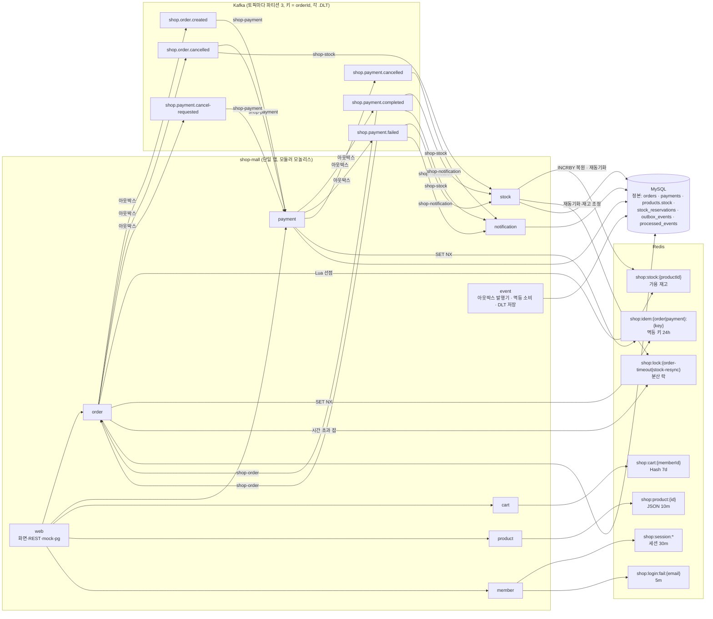
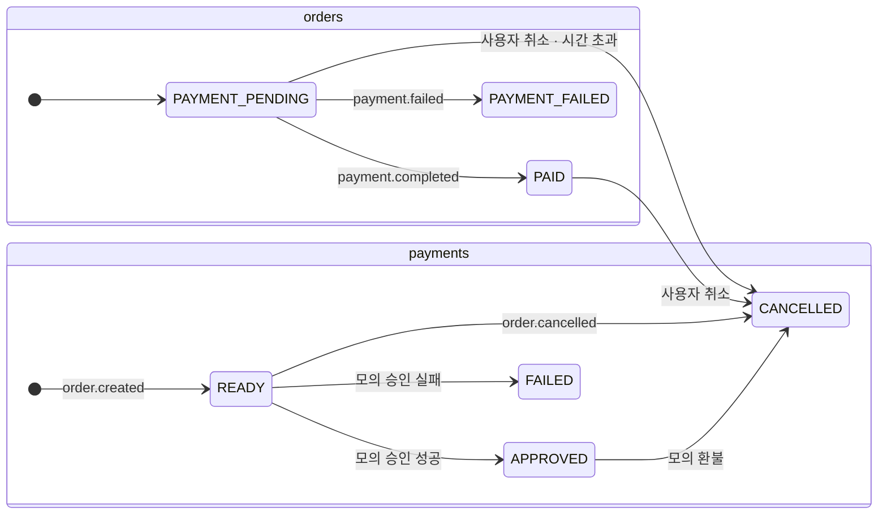

# 아키텍처 (REQ-NF-005 2)

하나의 Spring Boot 앱(`com.example.shop`) 안에 모듈 10개가 있다. 모듈이 다른 모듈의 상태를 바꿀 때는 **Kafka 이벤트로만**
알린다(REQ-F-001). 이벤트는 아웃박스 테이블을 거쳐 발행되고, 소비는 `processed_events` 로 멱등하게 처리된다.
값은 모두 코드 기준이다 — 토픽 `event/EventTopics`, 그룹 `event/ConsumerGroups`, Redis 키 `common/RedisKeys`.

## 모듈 · 토픽 · Redis 키

## 토픽과 소비자

| 토픽 | 생산 (아웃박스 기록 위치) | 소비 그룹 → 처리 |
|------|--------------------------|------------------|
| `shop.order.created` | order — `OrderService` (주문 트랜잭션) | `shop-payment` → READY 결제 생성 |
| `shop.order.cancelled` | order — `OrderCancellationService`, `PaymentTimeoutJob` | `shop-stock` → 선점·확정 재고 복원 / `shop-payment` → READY 취소, APPROVED 면 모의 환불 + payment.cancelled |
| `shop.payment.completed` | payment — `MockPgApprovalService` (승인 트랜잭션) | `shop-order` → PAID (취소된 주문이면 payment.cancel-requested) / `shop-stock` → 확정(DB 차감) / `shop-notification` → 알림 로그 |
| `shop.payment.failed` | payment — `MockPgApprovalService` | `shop-order` → PAYMENT_FAILED / `shop-stock` → 선점 복원(Redis INCRBY) / `shop-notification` → 알림 로그 |
| `shop.payment.cancelled` | payment — `PaymentLifecycleService.refund` | `shop-notification` → 알림 로그 |
| `shop.payment.cancel-requested` | order — `OrderPaymentResultService` | `shop-payment` → 모의 환불 + payment.cancelled |
| `<topic>.DLT` (6개) | `DeadLetterPublishingRecoverer` (재시도 소진·재시도 불가 오류) | `shop-dead-letter` → `dead_letter_events` 저장, 관리자 화면에서 재처리 |

## Redis 키의 쓰임 (코드 기준)

| 키 | 쓰는 곳 | 비고 |
|----|---------|------|
| `shop:stock:{productId}` | `stock/AvailableStockCounter` (`stock-reserve.lua` 선점, `stock-add.lua` 복원·조정·보상), `AvailableStockSynchronizer` (덮어쓰기) | 정본은 DB. 재동기화 값 = `products.stock − RESERVED 수량` |
| `shop:stock-sync:epoch` | `AvailableStockSynchronizer` (INCR), `AvailableStockCounter` (보상 시 비교) | 재동기화 뒤에 늦게 온 롤백 보상을 건너뛰기 위한 회차 (리뷰 Medium-2) |
| `shop:idem:order:{key}` · `shop:idem:payment:{orderId}` | `common/IdempotencyKeys` | 두 번째 겹은 DB 유니크 키(`orders`)·조건부 UPDATE(`payments`) |
| `shop:lock:order-timeout` · `shop:lock:stock-resync` | `common/RedisLock` (SET NX PX + 소유자 확인 해제 `lock-release.lua`) | 락은 첫 겹, 행 잠금·상태 확인이 두 번째 겹 |
| `shop:cart:{memberId}` | `cart/CartService` (`cart-add.lua`, `cart-set.lua`) | 가격 미저장 |
| `shop:product:{id}` | `product/ProductCacheConfig` (Spring Cache) | 가용 재고는 넣지 않음 |
| `shop:session:*` | Spring Session (`common/RedisSessionConfig`) | |
| `shop:login:fail:{email}` | `member/LoginAttemptService` (`login-failure.lua`) | 2단계에서 추가한 키 |
| `shop:event:done:{group}:{eventId}` | `RedisKeys.eventDone` 만 정의, **사용처 없음** | 소비 멱등은 DB `processed_events` 하나로 충분해 보조 키를 쓰지 않았다 (명세의 "보조" 키) |

## 상태 전이 (REQ-DA-001)

`stock_reservations.status` 는 `RESERVED → CONFIRMED | RELEASED`, `CONFIRMED → RELEASED`(결제 후 취소)이고, 바뀔 때는 항상
`where status = ?` 조건부 UPDATE 로 1회만 반영한다.

## 관련 문서

- 시퀀스 4종: [sequences.md](sequences.md)
- 설계 결정 기록: [adr/](adr/)
