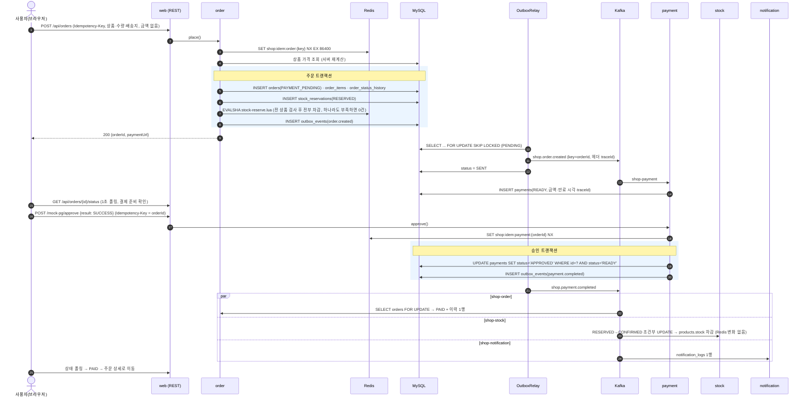
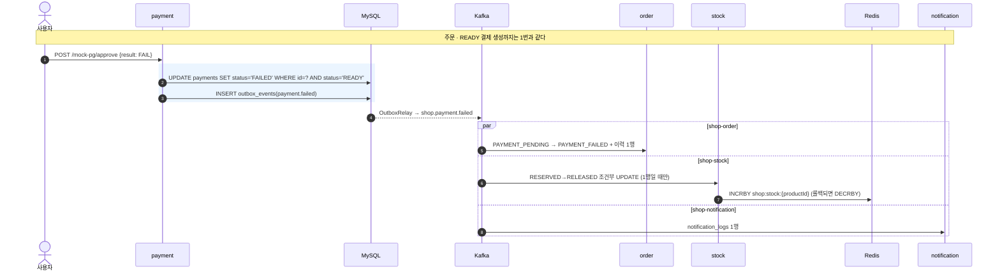
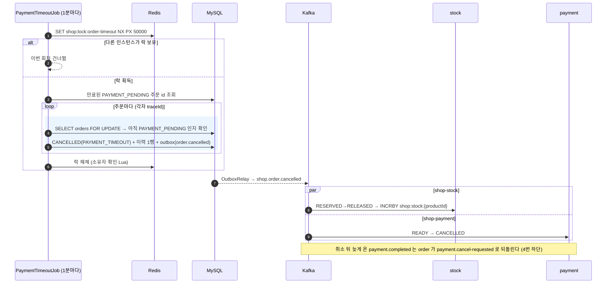
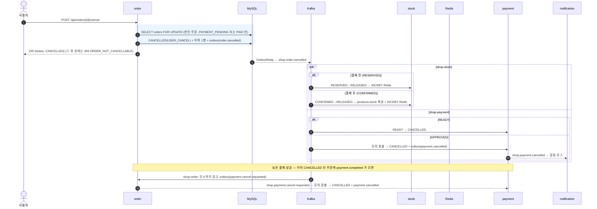

# 시퀀스 다이어그램 (REQ-NF-005 3)

네 흐름 모두 "한 트랜잭션 = 도메인 변경 + 아웃박스 1행" 이고, Kafka 발행은 `OutboxRelay`(500ms 폴링)가 커밋 뒤에 한다.
컨슈머 쪽 상자는 모두 `IdempotentEventProcessor` 의 한 트랜잭션(`processed_events` INSERT + 업무 처리)이다.
같은 이벤트가 두 번 와도 `processed_events` 기본 키 충돌로 두 번째는 건너뛴다. 그림에서는 생략한다.

## 1. 주문 → 결제 성공 → PAID

## 2. 결제 실패 → 재고 복원

## 3. 결제 시간 초과 자동 취소

## 4. 사용자 취소 (결제 전 · 결제 후)

